# chat-ui

A platform-independent UI toolkit for building LLM chat interfaces.

One small TypeScript core that mounts a complete chat surface — message primitives, streaming, composer, status line, optional panels — onto **any DOM element**, in any host: a React/Vue/Svelte app, a plain HTML page, a native webview (WebView2, WKWebView, Electron), or a widget inside another application. The host drives it through a small imperative handle and supplies user intent via an injected transport; the view never performs I/O itself.

## Why

Chat UIs keep being rebuilt per product and per framework. This package separates:

- **The view** — message primitives (parts), composer, scroll anchoring, IME-safe input, streaming markdown. One implementation, shared everywhere.
- **The transport** — how a "send" reaches your conversation engine (HTTP, SSE, a native-webview bridge, a worker, a test double). Injected by the host.
- **The features** — capability map: each optional UI region (queue, context card, quote chip, attachments, model picker, cost chip, interactive parts) is enabled per host.
- **The renderers** — renderer slots for message parts and card kinds, so hosts project their own domain without forking the view.

## Screenshots

Every shot below is captured from [`examples/screenshots.html`](examples/screenshots.html) — a static, deterministic page that mounts the real view (`?shot=<name>` renders one feature, `?shot=all` the full chat, `&theme=dark` the dark palette).

| Light | Dark |
| --- | --- |
| 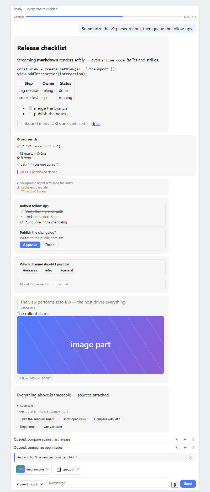 | 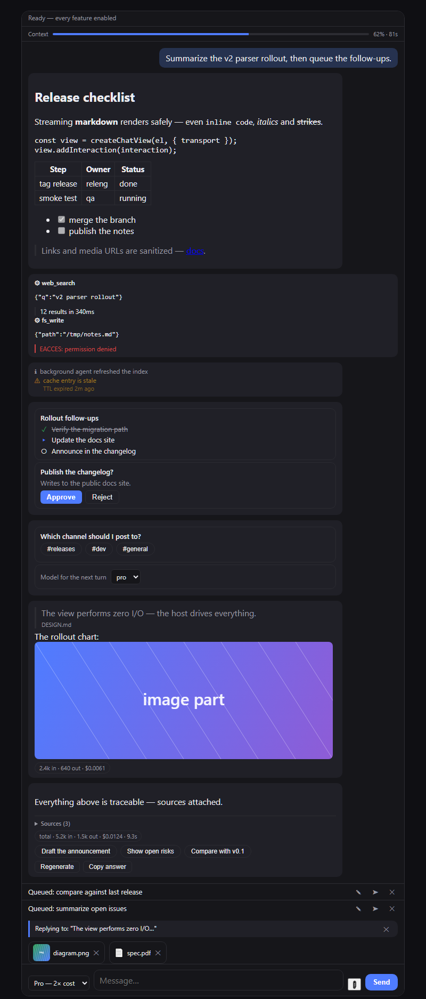 |

| Feature | Screenshot |
| --- | --- |
| **Streaming markdown** — headings, fences, tables, task lists, sanitized links | 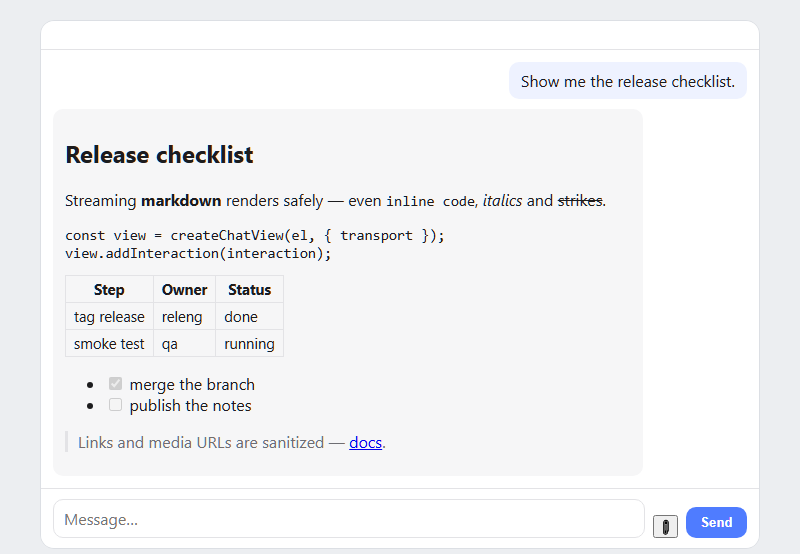 |
| **Tool calls** — invocations, results, error states | 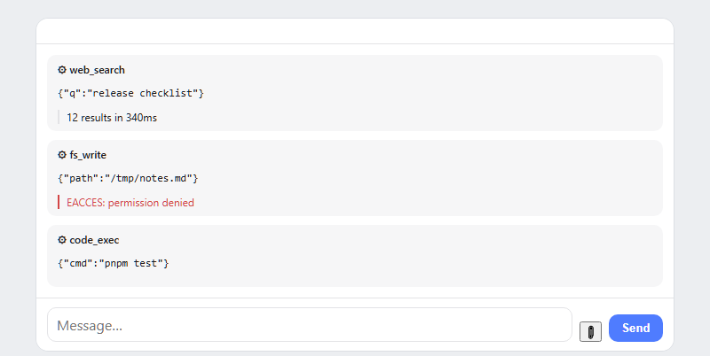 |
| **Cards** — task_plan, question, approval, model_select | 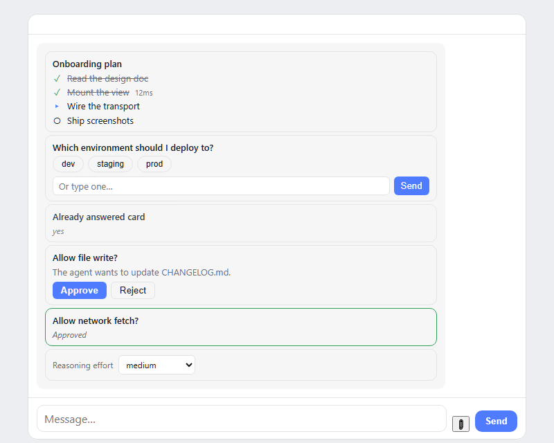 |
| **Quotes** — quote part plus the staged composer quote chip | 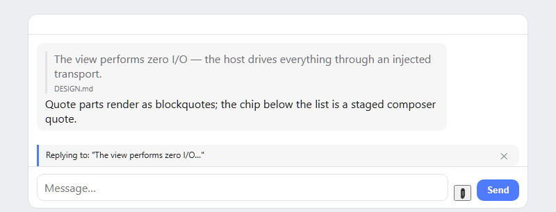 |
| **Suggestions** — clickable prompt chips | 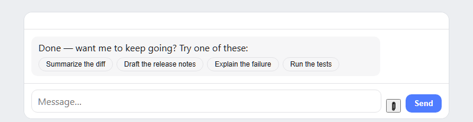 |
| **Usage** — per-turn usage part and `meta.usage` cost chip | 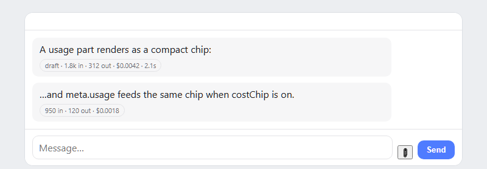 |
| **Evidence** — muted info/warning/error lines for background turns | 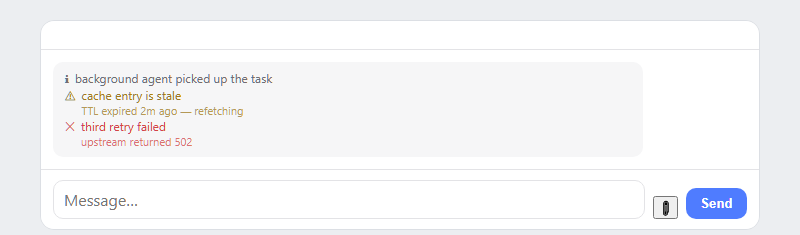 |
| **Attachments** — staged strip with image thumbnails | 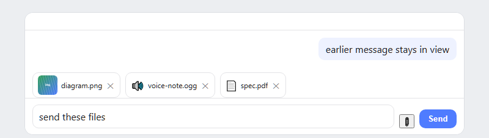 |
| **Chrome** — queue panel, context card, composer model picker | 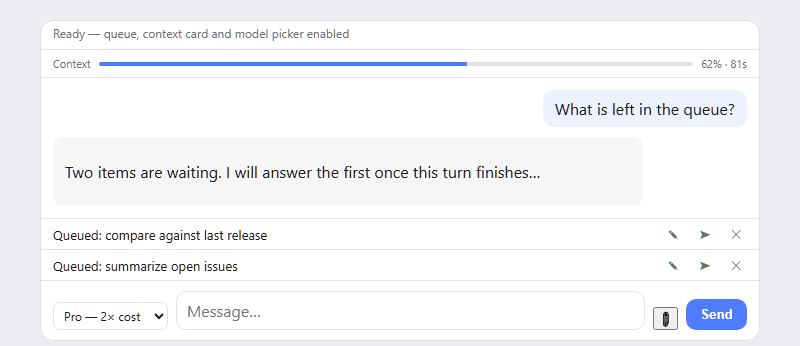 |
| **References** — collapsed "Sources" footer: sanitized links, verified badge, dates | 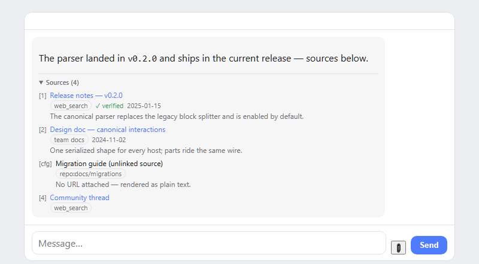 |
| **Subagent runs** — status badge, elapsed, progress meter, usage chip, cancel | 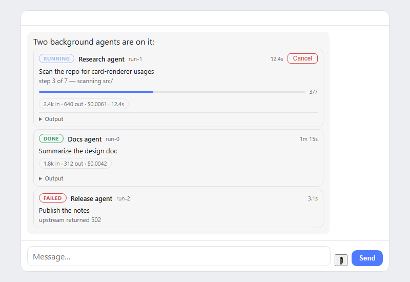 |
| **Images** — URL-sanitized image parts | 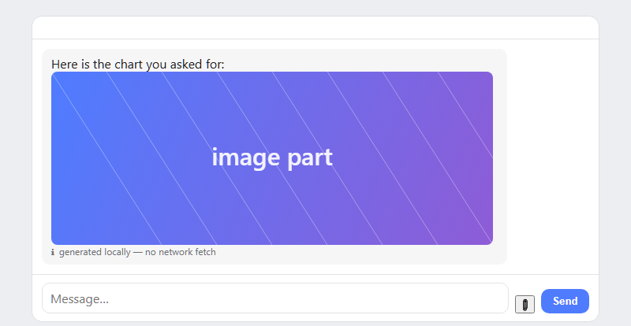 |

## Install

```bash
npm install @architects-toolkit/chat-ui
```

**No bundler?** Hosts without npm can vendor `dist/chat-ui.iife.js` (MIT) — it exposes `window.ChatUI` (`createChatView`, `defineChatUIElement`, `MarkdownStreamRenderer`, `DEFAULT_STYLES`, `interactionToMessage`, `interactionsToMessages`, …) and is safe to inject before `DOMContentLoaded`. A single-file ESM build ships as `dist/chat-ui.js`.

```html
<script src="chat-ui.iife.js"></script>
<script>
  const view = ChatUI.createChatView(document.getElementById('app'), {
    transport: { send: ({ text }) => window.hostBridge?.send(text) },
  });
</script>
```

## Quick start (any DOM host)

```ts
import { createChatView } from '@architects-toolkit/chat-ui';

const view = createChatView(document.getElementById('app')!, {
  transport: {
    async send({ text, attachments }) { /* deliver to your backend/session */ },
    cancel() { /* abort the in-flight response */ },
    messageAction(id, action, payload) { /* card answers, picks, approvals */ },
  },
  features: { queue: true, attachments: true, modelPicker: true, messageActions: true },
  deltaFormat: 'markdown',
});

view.addMessage({
  id: '1',
  role: 'assistant',
  parts: [{ type: 'markdown', text: '' }],
});
view.appendDelta('1', 'Hello — **streaming** markdown never renders broken `**` mid-token.');
view.updateMessage('1', { status: 'done' });
```

## Custom element (plain HTML / webviews)

```html
<chat-ui-view id="chat"></chat-ui-view>
<script type="module">
  import { defineChatUIElement } from '@architects-toolkit/chat-ui/element';
  defineChatUIElement();

  const handle = document.getElementById('chat').init({
    transport: { send: ({ text }) => window.hostBridge?.send(text) },
  });
</script>
```

## React

```tsx
function Chat({ transport }: { transport: ChatTransport }) {
  const ref = useRef<HTMLDivElement>(null);
  useEffect(() => {
    const view = createChatView(ref.current!, { transport });
    return () => view.destroy();
  }, [transport]);
  return <div ref={ref} style={{ height: '100%' }} />;
}
```

## Message parts

`ChatMessage.parts` is an ordered array of typed fragments. Built-in renderers cover:

| `part.type` | Renders |
| --- | --- |
| `text` | plain text (appendDelta target for raw streams) |
| `markdown` | safe subset: headings, fences, inline code, bold/italic/strike, links, images, lists, task lists, blockquotes, tables, rules — sanitized URLs |
| `html` | host-trusted markup |
| `image` / `audio` / `video` | media elements (URL-sanitized; `data:`/`blob:` allowed for media) |
| `quote` | blockquote with optional source cite |
| `suggestions` | clickable prompt chips (`messageAction` or composer fill) |
| `usage` | per-turn cost/usage chip (`tokensIn`, `tokensOut`, `cost`, `currency`, `durationMs`) |
| `evidence` | muted system line for background-agent/audit turns (`level: info\|warning\|error`) |
| `references` | collapsed "Sources (n)" citation footer — numbered `[id]` entries with title (linked only when `url` is safe), snippet, source label, verified badge, date |
| `tool_call` / `tool_result` | tool invocation + output blocks |
| `divider` | `<hr>` |
| `card` | typed card — see below |

### Card kinds

`{ type: 'card', kind, data }` — a small set of generic, well-typed kinds; interactive controls report through `transport.messageAction(messageId, action, payload)`:

| `kind` | data | interaction |
| --- | --- | --- |
| `task_plan` | `{ title?, steps: [{label, status?, detail?}] }` | read-only plan/todo list |
| `question` | `{ question, options?, allowFreeText?, placeholder?, submitLabel?, action?, answer? }` | chips + free-text input → `{ answer }` |
| `approval` | `{ title?, description?, approveLabel?, rejectLabel?, action?, state? }` | approve/reject → `{ decision }` |
| `model_select` | `{ label?, options, selected?, action? }` | `<select>` → `{ model }` |
| `subagent_run` | `{ id, name?, task?, status, detail?, startedAt?, finishedAt?, elapsedMs?, progress?, usage?, output?, cancellable?, action? }` | cancel while active → `{ id, status }` |
| any other string | host-defined | rendered via `partRenderers['card:<kind>']`, then `partRenderers['card']` |

Controls render **disabled** unless `features.messageActions` is on and `transport.messageAction` exists — nothing is interactive by accident.

### Subagent runs

`kind: 'subagent_run'` renders a background-agent run as a first-class card: a color-coded status badge (`running` pulses accent, `done` green, `failed`/`timeout` red, `cancelled` muted, `waiting*` amber, anything else neutral), the `name`/`id`, an elapsed figure (`elapsedMs`, else derived once at render from `startedAt`→`finishedAt` — the view runs no timers), the `task`/`detail`/`progress` lines (`{ done, total }` renders a meter, a string renders as-is), a `usage` chip (same format as the `usage` part) and `output` in a collapsed `<details>`. When `cancellable` is set and the status is `pending`/`running`/`waiting`, a Cancel button reports `{ id, status }` through `messageAction` under `action` (default `'subagent_cancel'`). To refresh a live card, push a patch — e.g. `view.updateInteraction(domKey, { parts: [{ type: 'card', kind: 'subagent_run', data: { ...run, status: 'done', elapsedMs: 12_400 } }] })`.

## Canonical interactions (the v2 protocol)

`CanonicalInteraction` is the serialized contract host applications converge on: each host maps its own domain objects (message DTOs, interaction objects, stream events) into **one canonical JSON shape** the view renders. It is JSON-safe end-to-end — `JSON.parse(JSON.stringify(i))` is lossless — so it crosses HTTP, SSE, native-webview bridges, and workers without codecs.

```ts
import { interactionToMessage, normalizeInteraction } from '@architects-toolkit/chat-ui';

// strict path — validates invariants, throws TypeError when broken
view.addMessage(interactionToMessage(myCanonicalInteraction));
// or program purely against the canonical vocabulary:
view.addInteraction(myCanonicalInteraction);
view.updateInteraction(domKey, { status: 'done' });
// tolerant path — for partial/streamed objects (never throws)
view.addInteraction(normalizeInteraction(streamChunk));
```

### Interaction schema

| field | required | notes |
| --- | --- | --- |
| `id` | ✓ | non-empty string; `TypeError` when missing/empty |
| `parts` | ✓ | array of parts; `TypeError` when not an array |
| `role` | ✓ | `'user' \| 'assistant' \| 'system' \| 'tool' \| 'background'` — `background` renders as `system`; unknown values normalize to `assistant` |
| `domKey` | | stable key for `updateInteraction`/`appendDelta`/`removeMessage` (defaults to `id`) |
| `status` | | `'queued' \| 'streaming' \| 'done' \| 'error'` — pending/streaming visuals |
| `meta` | | JSON-safe host data; `meta.usage` feeds the cost chip, `meta.actions` the actions row |

`normalizeInteraction(partial)` fills every missing field: generated `cui-N` id, `role: 'assistant'`, `parts: []`.

### Part schema (`CanonicalPart` = `MessagePart`)

| `type` | required | optional fields |
| --- | --- | --- |
| `text` | `text` | — |
| `markdown` | `text` | — |
| `html` | `html` | — (host-trusted markup) |
| `image` | `src` | `alt`, `name` |
| `audio` | `src` | `name`, `mimeType` |
| `video` | `src` | `name`, `mimeType`, `poster` |
| `divider` | — | — |
| `tool_call` | `name` | `args`, `status` (`pending\|running\|done\|error`) |
| `tool_result` | `content` | `name`, `isError` |
| `quote` | `text` | `source` |
| `suggestions` | `prompts` (string[]) | — |
| `usage` | `usage` | `label`, `tokensIn`, `tokensOut`, `cost`, `currency`, `durationMs` |
| `evidence` | `text` | `detail`, `level` (`info\|warning\|error`) |
| `references` | `items` (ReferenceItem[]) | item fields: `id`, `title`, `url`, `snippet`, `source`, `verified`, `publishedAt` |
| `card` | `kind` | `data` (see card kinds above) |

Malformed entries (non-objects, missing `type`) are dropped at the boundary; unknown-but-well-formed `type`s pass through to your `partRenderers` registry — custom parts ride the same wire.

```json
{
  "id": "turn-42",
  "role": "assistant",
  "status": "done",
  "parts": [
    { "type": "markdown", "text": "Here is the **plan**." },
    { "type": "card", "kind": "task_plan",
      "data": { "steps": [{ "label": "scan", "status": "done" }] } },
    { "type": "usage", "usage": { "tokensIn": 812, "tokensOut": 96, "cost": 0.0031 } }
  ],
  "meta": { "turnId": "t-42" }
}
```

### Host mapping recipe

Your domain object → `CanonicalInteraction`, then straight to the view:

```ts
const interaction: CanonicalInteraction = {
  id: dto.id,
  domKey: dto.conversationKey,
  role: dto.authorKind === 'agent' ? 'background' : dto.authorKind,
  status: dto.streaming ? 'streaming' : 'done',
  parts: dto.blocks.map(toCanonicalPart), // your mapper
  meta: { usage: dto.usage },
};
view.addInteraction(interaction);
```

### Lifecycle

`addInteraction(i)` → `updateInteraction(domKey, patch)` → `appendDelta(domKey, delta)` for token streaming → `removeMessage(domKey)` to drop. Same addressing model as `addMessage` — `domKey ?? id` is the update key.

### Adoption path

1. **Stage 1 — parity cutover**: keep your existing rendering, wrap its HTML output in `{ type: 'html', html }` parts inside canonical interactions. One mapping function, full visual parity, zero renderer work.
2. **Stage 2 — native parts**: migrate part types incrementally (`html` blocks → `markdown`, custom widgets → typed `card` kinds or `partRenderers`). The wire shape never changes — only your mapper shrinks.

## Streaming

`appendDelta(domKey, delta)` appends to the message's last `text`/`markdown` part (or creates one of `options.deltaFormat` type). For `markdown` parts an incremental renderer freezes completed paragraphs and re-renders only the unstable tail, so partial `**`, ```` ``` ````, or `[label](` never produce broken markup or flicker (approach ported from Deep Chat — see `THIRD_PARTY_NOTICES.md`). `updateMessage` re-renders canonically.

## Composer

- **IME-safe**: Enter never submits mid-composition (`compositionstart`/`compositionend` + `isComposing`/`keyCode 229`); the same guard covers Escape.
- **Scroll anchoring**: the list stays pinned only while the user is at/near the bottom; scrolling up shows a "↓ Latest" jump button. Instant scroll — no motion, `prefers-reduced-motion` safe.
- **Autosize** textarea, paste-to-attach, staged-attachment strip with image thumbnails and removal.
- **Handle API** — hosts drive the composer through `ChatViewHandle`, never by reaching into `.cui-*` DOM nodes:
  - `getComposerText()` — current input value (`''` after `destroy()`).
  - `setComposerText(text, { focus: true })` — prefill + autosize; `focus` also focuses with the cursor at the end (edit-and-resend).
  - `focusComposer()` — focus the input.
  - `setComposerEnabled(bool)` — toggles the textarea plus send/attach buttons. Composes with `setProcessing`: the composer is interactive only while enabled **and** not processing, so the two may be called in any order — processing never re-enables a disabled composer.
  - `setPlaceholder(text)` — swap the input placeholder.
  - All composer methods are safe no-ops on a destroyed view.

## Attachments & media

`ChatSubmit.attachments` is `readonly (File | ChatAttachment)[]` — picked/pasted files arrive as `File`; hosts can stage typed refs (`{ kind: 'image'|'audio'|'video'|'file'|…, name, url?, file? }`) via `view.stageAttachments(...)` — e.g. a speech-to-text recording. Use `isChatAttachment(x)` to discriminate. `features.inputModes` declares the input surface for capability negotiation (`'text'`, `'attachments'`, `'audio'`, …).

When `transport.requestAttachments` is defined, clicking 📎 calls it instead of the built-in `<input type=file>` (which is not created) — the host supplies files out-of-band (e.g. a native file dialog) and pushes them back through `view.stageAttachments(...)`. Host-staged items ride `ChatSubmit.attachments` on send exactly like picked ones, and the strip clears after submit; paste-to-attach works the same either way.

## Feature map

| Feature | UI it enables | Transport members used |
| --- | --- | --- |
| `queue` | outgoing-message panel: edit / send-now / remove | `editQueued`, `sendQueuedNow`, `removeQueued` |
| `contextCard` | context-usage meter + elapsed time | — (`setContextUsage`) |
| `quoteChip` | staged quote chip above the composer | — (`stageQuote`/`getQuote`) |
| `attachments` | 📎 button + preview strip (`attachmentAccept`, paste) | `requestAttachments` (optional host picker) |
| `inputModes` | declared input affordances; gates the attach button | — |
| `modelPicker` | composer model `<select>` (`setModels`) | `selectModel` |
| `costChip` | per-message usage chip from `meta.usage` | — |
| `messageActions` | interactive parts (cards, suggestions, actions rows) | `messageAction` |

## Renderer slots

```ts
createChatView(el, {
  transport,
  partRenderers: {
    'card:invoice': (part, ctx) => /* HTMLElement */,
    'audio':        (part, ctx) => /* override a built-in */,
  },
});
```

## Theming

Three tiers, in order of increasing host ownership:

1. **Tokens** — every visual in `DEFAULT_STYLES` reads a `--cui-*` custom property. Set them on the `.chat-ui` element or any ancestor (own CSS, inline styles, or `extraCss`); `options.theme` stamps `data-theme` on the root — `'dark'` selects the built-in dark palette, any other name is host-defined and consumed through `[data-theme='brand']` selectors.
2. **`options.extraCss`** — a second `<style>` element injected right after `DEFAULT_STYLES`, so token overrides, theme variants and small rules ship with the mount config.
3. **`options.unstyled`** — suppresses `DEFAULT_STYLES` entirely; the host owns every rule. `extraCss` is still injected — it is host-supplied CSS either way.

All injected sheets carry a `data-cui-styles` attribute (`'default'` | `'extra'`) so tests and tooling can query them.

### Token reference

| Token | Default | Drives |
| --- | --- | --- |
| `--cui-bg` | `#ffffff` | view background, inputs, pickers, jump button |
| `--cui-fg` | `#1c1c1e` | primary text |
| `--cui-muted` | `#6e6e73` | secondary text, status line, meta labels |
| `--cui-border` | `#e3e3e6` | border/divider color |
| `--cui-accent` | `#4f7cff` | primary actions, links, accents, progress meters |
| `--cui-accent-fg` | `#ffffff` | text/icons on accent surfaces |
| `--cui-accent-subtle` | `transparent` | subtle accent tint on hover states and chips (suggestion/actions hover, usage + source chips, running badge) |
| `--cui-user-bg` | `#eef2ff` | user bubble |
| `--cui-assistant-bg` | `#f6f6f7` | assistant bubble + staged quote chip |
| `--cui-system-bg` | `transparent` | system message background |
| `--cui-error` | `#d34545` | error states, cancel, rejection borders |
| `--cui-ok` | `rgb(47,158,87)` | success tones — approved cards, done steps, verified badge, `ok` run badge |
| `--cui-warn` | `rgb(160,122,31)` | warning tones — evidence warnings, `waiting` run badge |
| `--cui-radius` | `10px` | corner radius; inner elements derive via `calc()` |
| `--cui-border-width` | `1px` | border/outline stroke; accent bars derive via `calc()` |
| `--cui-shadow` | `0 1px 4px rgba(0,0,0,0.18)` | jump-to-latest elevation |
| `--cui-shadow-sm` | `none` | card/chip elevation (cards, suggestions, attachments) |
| `--cui-bubble-maxw` | `85%` | message bubble max width |
| `--cui-gap` | `10px` | gap between messages |
| `--cui-pad` | `8px 12px` | message bubble padding |
| `--cui-font` | `inherit` | font shorthand for the whole view |
| `--cui-font-size` | `inherit` | base font size — overrides the shorthand's size part |
| `--cui-font-size-sm` | `12px` | small text; the 10–13px scale derives via `calc()` on this |
| `--cui-font-mono` | `ui-monospace, monospace` | code font |
| `--cui-line-height` | `inherit` | base line height — overrides the shorthand's line-height part |

`data-theme='dark'` overrides `--cui-bg`, `--cui-fg`, `--cui-muted`, `--cui-border`, `--cui-user-bg` and `--cui-assistant-bg`. Because `--cui-font-size`/`--cui-line-height` take precedence over the `--cui-font` shorthand, use `--cui-font` for family/weight/style and the dedicated tokens for metrics.

### Brand matching

A host matching its design system through configuration alone — near-black surfaces, lime accent, hairline borders, square-ish corners:

```ts
const view = createChatView(el, {
  transport,
  theme: 'brand',
  extraCss: `
    .chat-ui[data-theme='brand'] {
      --cui-bg: #0b0b0d;
      --cui-fg: #e8e8ea;
      --cui-muted: #8a8a92;
      --cui-border: #26262b;
      --cui-assistant-bg: #141416;
      --cui-user-bg: #1e2413;
      --cui-accent: #b8f540;
      --cui-accent-fg: #11130a;
      --cui-accent-subtle: rgba(184,245,64,0.08);
      --cui-border-width: 0.5px;
      --cui-radius: 6px;
      --cui-shadow-sm: 0 1px 3px rgba(0,0,0,0.4);
    }
  `,
});
```

The same overrides could live in the host's own stylesheet — `extraCss` just keeps them next to the mount config (and lets the host flip `theme` per instance).

## Design

See [DESIGN.md](./DESIGN.md) for the architecture contract: message/parts model, transport lifecycle, renderer registry, streaming semantics, and versioning rules.

## Credits

Includes algorithms ported from [Deep Chat](https://github.com/OvidijusParsiunas/deep-chat) (MIT, © Ovidijus Parsiunas) — streaming markdown segmentation, scroll anchoring, IME composition guard, and URL sanitization. See [THIRD_PARTY_NOTICES.md](./THIRD_PARTY_NOTICES.md).

## License

MIT © architects-toolkit contributors
